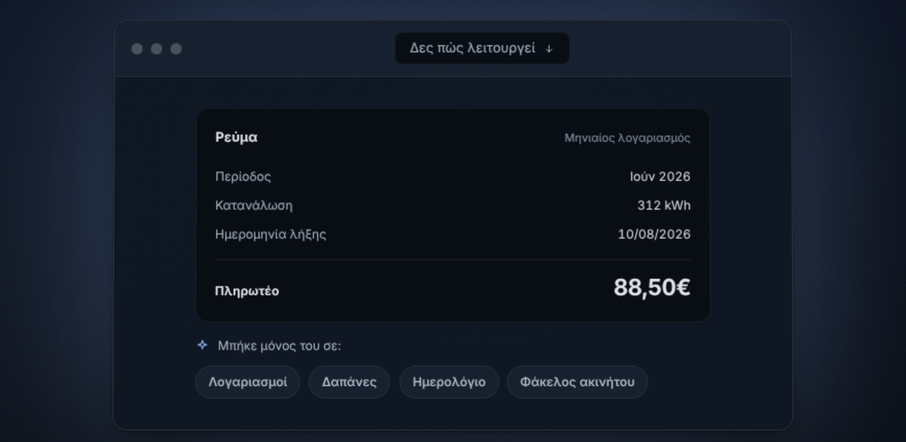
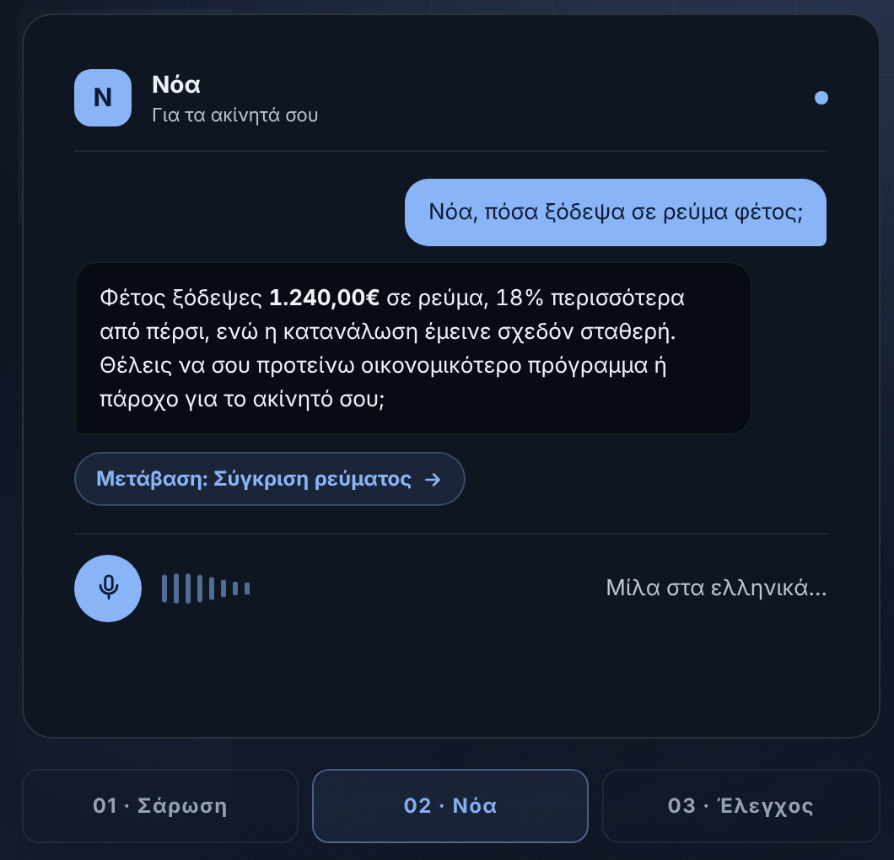
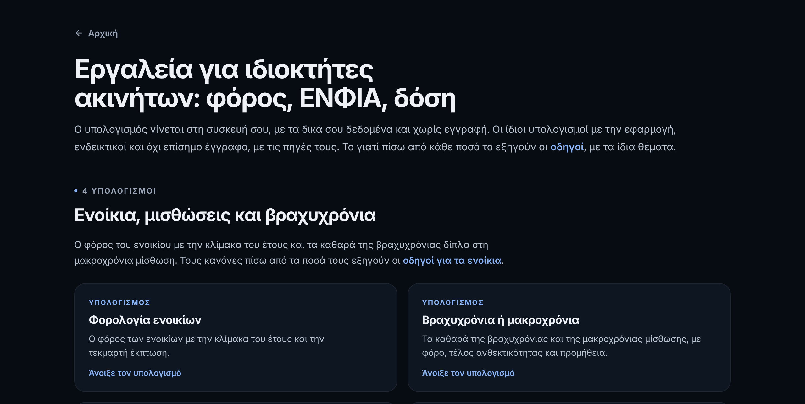
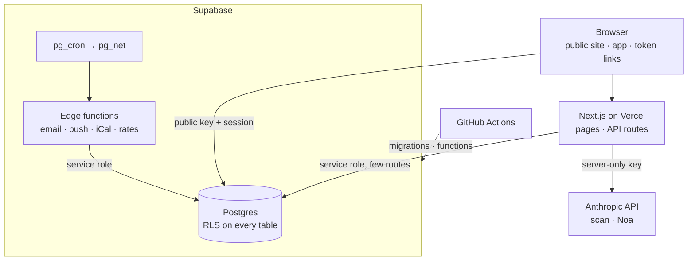

<div align="center">

<picture>
  <source media="(prefers-color-scheme: dark)" srcset="public/brand/properwise-logotypo-lefko.png">
  
</picture>

**Property management for Greek owners, managers and their accountants.**<br/>
Photograph a bill, a lease or a receipt; income, expenses, tenants, tax and deadlines follow.

_Διαχείριση ακινήτων με μία φωτογραφία._

[properwise.gr](https://properwise.gr) · [Calculators](https://properwise.gr/ergaleia) · [Guides](https://properwise.gr/odigos) · [For accountants](https://properwise.gr/logistes)

</div>

> **Private repository.** Proprietary code and infrastructure for a production
> service that holds customer data. The public face of the product is
> [properwise.gr](https://properwise.gr).

---

<table>
<tr>
<td width="62%"></td>
<td width="38%"></td>
</tr>
<tr>
<td><sub>One photo of a bill fills the record and files it in four places.</sub></td>
<td><sub>Noa answers from the owner's own numbers, in Greek, by text or voice.</sub></td>
</tr>
</table>

<sub>Public pages of properwise.gr, dark theme, captured 04/11/2026. No user data.</sub>

## Contents

[What it does](#what-it-does) · [How quality is held](#how-quality-is-held) · [Architecture](#architecture) · [Repository layout](#repository-layout) · [Local development](#local-development) · [CI/CD](#cicd) · [Documentation](#documentation)

## What it does

### For owners

- **Scan anything the property produces.** Utility bills from any provider,
  professionals' receipts (ΑΠΥ/ΤΠΥ) with the category taken from the work done,
  common charges (κοινόχρηστα), tax documents (Ε1, Ε2, Ε9, ΕΝΦΙΑ), payout and
  commission statements from short-stay platforms, multi-page PDFs and files
  that hold several documents. Photo or PDF, with one size limit shared by the
  screen, the server and the storage bucket and held equal by a test
  (`lib/billing/scanPrompt.ts`).
- **An archive an accountant can file.** Every document lives in
  _kind → provider → year_ and downloads under one name,
  `Είδος_Πάροχος_ΕΕΕΕ_ΜΜ_Ποσό.ext`. The name is computed, not stored, so old
  files follow every correction (`lib/archive/`).
- **Rent and tenants.** Lease ledger, statements and receipts, a tenant portal,
  one-tap «Πλήρωσα» from a reminder. Rent adjustment by a fixed rate or by the
  ΕΛΣΤΑΤ consumer price index, with the commercial-lease cap where it applies,
  and a signed PDF notice to the tenant (`lib/documents/rentAdjustment.ts`).
- **Tax and deadlines.** Rental income tax, ΕΝΦΙΑ and its instalments, the
  owner's deadlines month by month, all pushed into the calendar, reminders and
  the phone. The ΕΝΦΙΑ act imports straight from myAADE (`lib/myaade/`).
- **Bills, loans, short stays.** Tariff comparison with the date prices were
  checked, mortgage instalments, iCal sync with Airbnb and Booking, dynamic
  pricing and occupancy.
- **Noa.** Answers questions about the owner's own properties in Greek, from the
  owner's own data, and opens the screen that does the job. Tax examples come
  from the same calculators as the rest of the app; answers are scored against
  a fixed question set (`npm run noa:eval`).

### For managers

Portfolio view across properties, organizations with team permissions, a client
and guest CRM with stay history, co-owner splits, branded investor reports,
guest check-in links and Excel/CSV export everywhere.

### For accountants

A read-only, revocable link to each client's year: one row per property, what is
missing listed first, an Ε1/Ε2 code sheet and an Excel workbook that opens in
their own software. Bulk invitations and all client folders in one download.
Public page: [/logistes](https://properwise.gr/logistes).

### In public, without an account



Calculators for ΕΝΦΙΑ, rental tax, rent adjustment, purchase costs, yield,
mortgage, electricity tariffs and more, plus long-form guides that explain the
rules behind each figure. Every calculator runs the same engine as the app and
cites its sources. Each list is written once: `lib/core/publicTools.ts` feeds
the footer, the hub and `llms.txt`; `app/odigos/guides.ts` feeds the guides
index, the sitemap dates and the related-guide links.

The public shell is bilingual: Greek first, English under `/en` for the home
page, pricing, sign-in, legal pages, calculators and guides, paired route by
route with `hreflang` (`lib/i18n/paths.ts`). The app itself is Greek.

## How quality is held

Rules that matter are code, not convention. Each line below names the place
where the rule is enforced.

| Rule | Where it is enforced |
|---|---|
| **Guards that prove themselves** | Every `scripts/guard-*.mjs` is discovered and run by `npm run guards`; nothing to register. Each one has a mutation in `scripts/lib/mutations.mjs` that injects the exact bug it exists for, and `npm run guards:verify` requires it to turn red. A guard that cannot fail does not merge. |
| **Ratchets that only go down** | Lint debt (`lint:ratchet`), raw colours (`color:ratchet`), visual defects (`optiki:ratchet`), client page weight (`docs/perf/budget.json`), server bundle weight (`docs/perf/server.json`) and the design scale. A raise needs an explicit, explained baseline change. |
| **Layout on real engines** | Browser scanners over a matrix of phones, tablets and desktops, in Chromium and in WebKit, dark and light: horizontal scroll, overlaps, tap targets, alignment, label heights, number columns, keyboard reach, accessibility. |
| **The database, executed** | `npm run db:replay` builds every migration on a real Postgres, replays the app's own writes as an authenticated user (`scripts/db/write-flows.ts`) and probes Row-Level Security by asking, as tenant A, for tenant B's rows (`scripts/db/rls-probe.sql`). |
| **One source per number** | Each figure is computed once in `lib/facts/` and shown everywhere with the same label ([`docs/facts.md`](docs/facts.md)). Tax, ΕΝΦΙΑ and price figures come from `lib/tax/` and `lib/billing/`; a number typed by hand in copy is a guard failure. |
| **Production, watched** | Scheduled checks for tax-data validity, ΑΑΔΕ form editions, the ΕΛΣΤΑΤ index, price freshness, a daily security sweep, a weekly quality pass and a watchdog on the nightly backup. |

`npm run guards` and `npm test` print the current number of guards and suites.
This README states none on purpose: counts written here went stale, and
`scripts/guard-readme-counts.mjs` keeps them out.

## Architecture



- **Two trust boundaries.** The browser reaches Postgres only with the public key
  and the user's session, so Row-Level Security decides every read and write.
  Privileged work runs in edge functions and in the few server routes RLS
  cannot judge (webhooks, token links); the service client may only be
  imported from server files (`lib/supabase/service.ts`, held by a guard).
- **Strict CSP.** A per-request nonce with `strict-dynamic`, no inline scripts
  (`proxy.ts`). Webhooks are verified in constant time.
- **No tracking.** No advertising or analytics cookies; traffic is measured
  anonymously and without cookies.

## Repository layout

```
app/                Next.js App Router: public site, /en, auth, dashboard, portals, API routes
  dashboard/        The signed-in app
  portal/ accountant/ checkin/ imerologio/ plirosa/   Token-gated links for tenants, accountants, guests
  odigos/ ergaleia/ Guides and the calculators hub
components/         Shared UI on one token layer (app/globals.css)
lib/                Domain logic, framework-free and unit-tested
  tax/ billing/ accounting/ archive/ documents/ facts/ i18n/ myaade/ rent/ assistant/ …
supabase/
  migrations/       The schema, rebuilt from scratch in CI
  functions/        Edge functions (Deno) and _shared modules
scripts/            Guards, ratchets, browser scanners, db-replay, generators
docs/               Engineering, database, infrastructure, performance, org
```

## Local development

Node 22, as in CI.

```bash
npm ci
cp .env.example .env.local      # fill in the Supabase and provider keys
npm run dev                     # http://localhost:3000
```

> This project tracks a fast-moving Next.js release. Read the bundled guides in
> `node_modules/next/dist/docs/` before touching framework code; see
> [`AGENTS.md`](AGENTS.md). After a squash merge, restack the branch with
> `bash scripts/rebranch.sh`.

The checks CI runs, locally:

```bash
npm test                        # every *.test.ts and the messaging verifiers
npm run guards                  # every guard, in parallel
npm run guards:verify           # each guard turns red on its own mutation
npm run lint:ratchet            # lint errors may only go down
npx tsc --noEmit                # strict typecheck
npm run db:replay               # migrations, writes and RLS on Postgres 16
```

Run `npm run guards` without a pipe: `npm run guards | tail` reports the exit
code of `tail`.

## CI/CD

| Workflow | When | What |
|---|---|---|
| `ci.yml` | every pull request to `main` | Secret scan, dependency audit, lint ratchet, typecheck (app and Deno), guards and their mutations, db-replay, tests, production build, bundle secret scan, then the browser suites. One gate job must be green. |
| `supabase-deploy.yml` | push touching migrations, functions or their config | Migrations and edge functions: `claude/**` to staging, `main` to production, with a failure alert. |
| `db-backup.yml` · `backup-watchdog.yml` | daily | Logical dump to a private artifact; a later job raises an alert when the latest one is missing. |
| `security-daily.yml` · `weekly-quality.yml` | scheduled | Security sweep and a production quality pass. |
| `health.yml` | push to `main` | Production health right after a release; between releases the `health-check` edge function runs from pg_cron. |
| `validity.yml` · `aade-editions.yml` · `elstat-cpi.yml` · `price-freshness.yml` | scheduled | Tax-data validity, ΑΑΔΕ form editions, the rent index, tariff prices. |
| `db-types.yml` | schema change on `main` | Opens a pull request with regenerated database types. |

A pull request with a merge conflict runs no CI at all; it looks pending, not
red. Dependabot keeps npm packages and Actions current through the same gate.

## Documentation

| Document | Covers |
|---|---|
| [`supabase/README.md`](supabase/README.md) | Schema reference |
| [`docs/db/rls-conventions.md`](docs/db/rls-conventions.md) | Row-Level Security model |
| [`docs/db/security-and-automation.md`](docs/db/security-and-automation.md) | Security posture and automation |
| [`SECURITY.md`](SECURITY.md) · [`docs/security-known-accepted.md`](docs/security-known-accepted.md) | Reporting, and findings accepted on purpose |
| [`docs/infra/runbook.md`](docs/infra/runbook.md) · [`docs/infra/staging-setup.md`](docs/infra/staging-setup.md) | Deploys, secrets, backups, incidents, staging |
| [`docs/infra/acquisition-readiness.md`](docs/infra/acquisition-readiness.md) | Technical due-diligence checklist |
| [`docs/perf/README.md`](docs/perf/README.md) | How weight and speed are measured |
| [`docs/facts.md`](docs/facts.md) | Every figure, its function and its screens |
| [`.claude/skills/fylakas/SKILL.md`](.claude/skills/fylakas/SKILL.md) | How to write a guard |

---

<div align="center"><sub>© PROPERWISE. All rights reserved. Proprietary and confidential.</sub></div>
