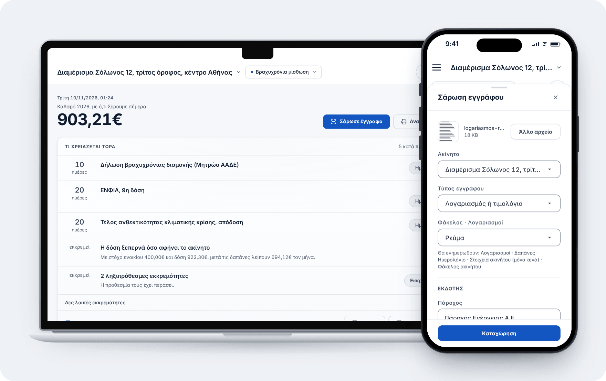
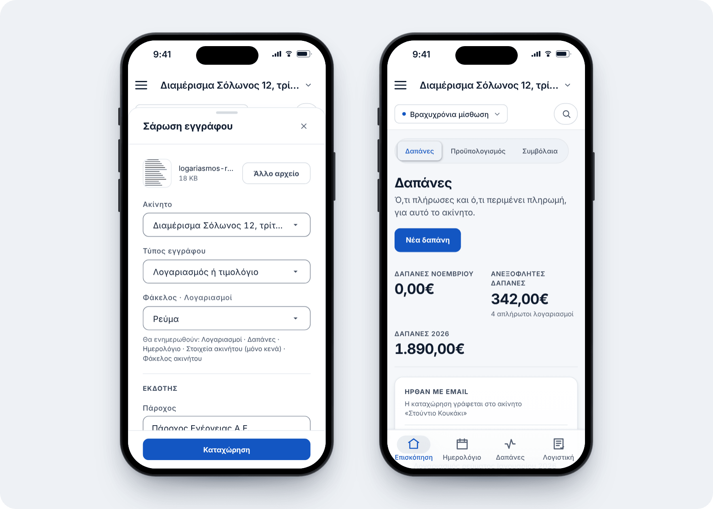
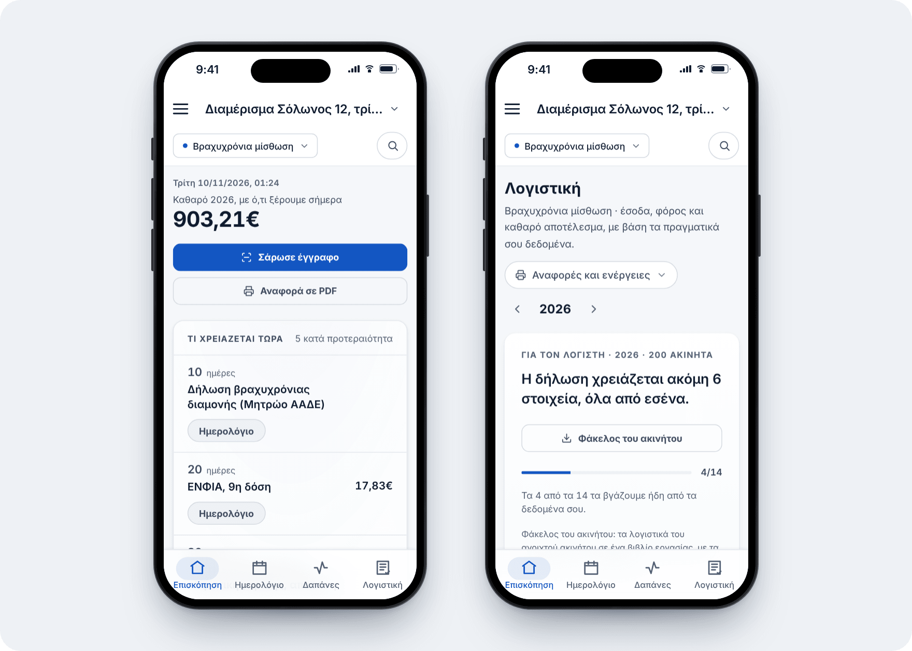
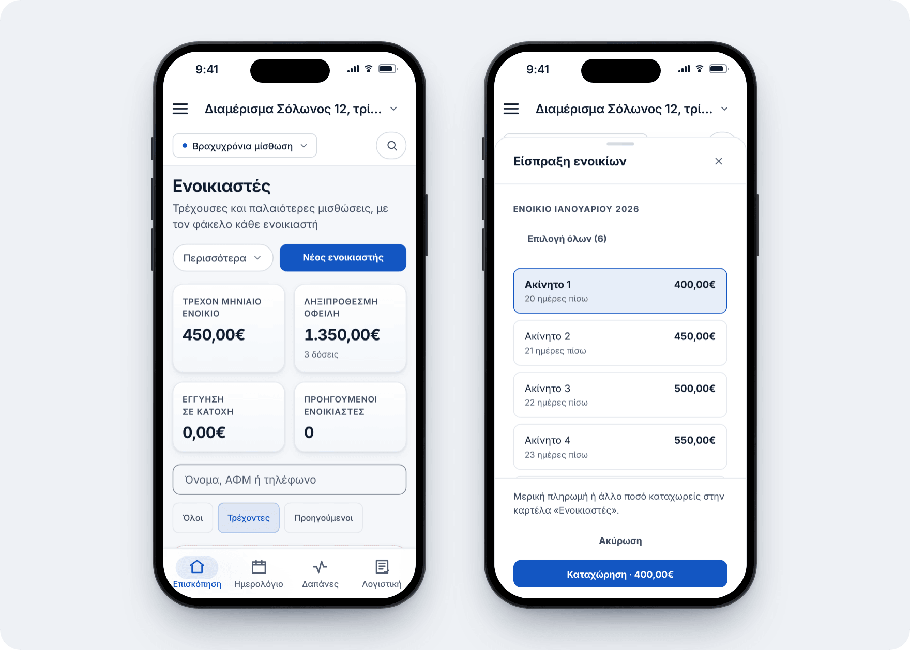
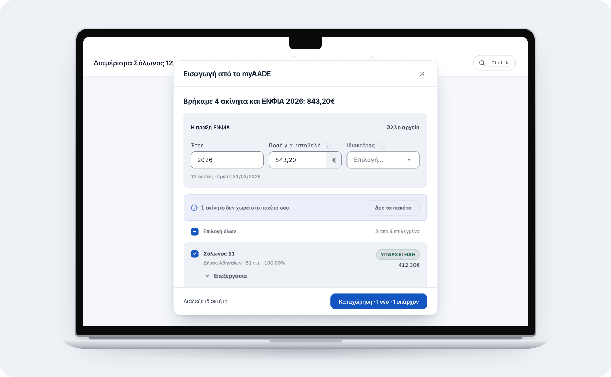
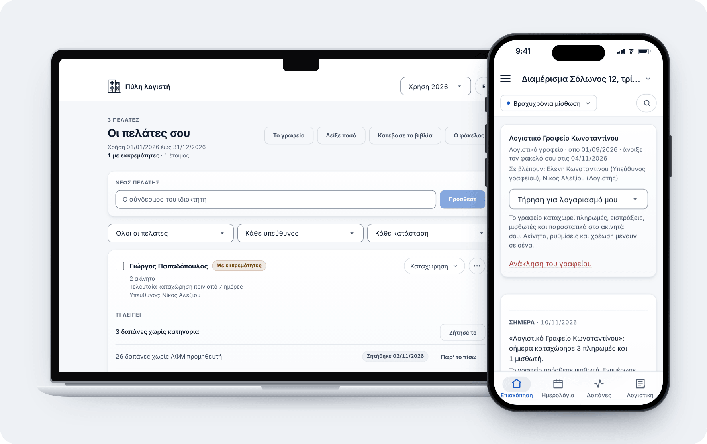
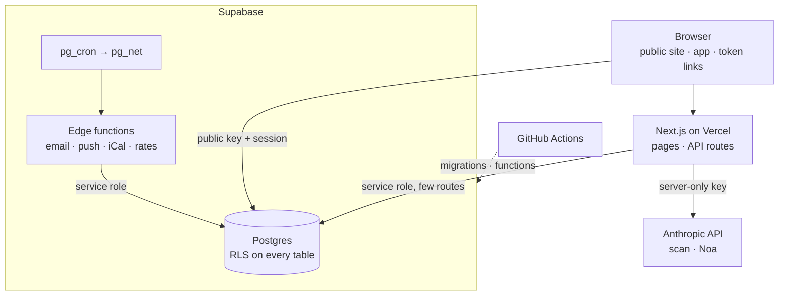

<div align="center">

<picture>
  <source media="(prefers-color-scheme: dark)" srcset="public/brand/properwise-logotypo-lefko.png">
  
</picture>

### The paperwork of owning property in Greece, kept by one app.

Photograph a bill, a lease or a receipt. Income, expenses, tenants, tax and deadlines follow,<br/>
and the accountant gets a year that is ready to file.

[**properwise.gr**](https://properwise.gr) · [English](https://properwise.gr/en) · [For accountants](https://properwise.gr/en/for-accountants) · [Calculators](https://properwise.gr/en/tools) · [Pricing](https://properwise.gr/en/pricing) · [Trust](https://properwise.gr/en/trust)

<br/>



<sub>The app in its light theme, with sample data. Interface in Greek.</sub>

</div>

> **Private repository.** Proprietary code and infrastructure for a production
> service that holds customer data. The public face of the product is
> [properwise.gr](https://properwise.gr).

## The problem

A Greek landlord with one flat deals with the same state systems as a small
business. Every lease is declared to ΑΑΔΕ, the tax authority, and repeated on
form Ε2 with the yearly return. ΕΝΦΙΑ, the property tax, arrives as an act in
myAADE and is paid in instalments. Short stays need a registry number and their
own declarations. Utility bills, repair receipts, common charges and platform
payouts pile up in email, on paper and in photos on a phone.

When tax season opens, the accountant asks for all of it, sorted, and works out
the tax from whatever arrives.

PROPERWISE turns each document into a record the moment it arrives, keeps the
deadlines in one calendar, and gives the accountant a direct view of the year.

## What it does

### One photo, filed in four places



A photo or PDF of any bill, receipt, lease or tax document is read by the model
and turned into a draft: provider, period, amount, due date, property and
folder. The owner checks it and taps once. The same record updates bills,
expenses, the calendar and the property folder. Professionals' receipts get
their expense category from the work described on them
(`lib/billing/scanPrompt.ts`).

### Tax and deadlines that come to you



Rental income tax, ΕΝΦΙΑ and its instalments, the short-stay registry and the
owner's other deadlines, month by month, pushed to the calendar and the phone.
The accounting tab says how much of the return is already covered by the
owner's own data and what is still missing. Every figure comes from the same
calculators as the public tools (`lib/tax/`, `lib/facts/`).

### Rent and tenants



A ledger per lease, overdue balances, deposits, receipts and a tenant portal.
Rent for many properties is recorded in one step. Rent adjustment follows a
fixed rate or the ΕΛΣΤΑΤ consumer price index, with the commercial-lease cap
where it applies, and produces a signed notice for the tenant
(`lib/documents/rentAdjustment.ts`).

### Straight from myAADE



The ΕΝΦΙΑ act downloaded from myAADE is read in the browser, in a web worker,
by rule-based parsers written against the real forms. No model is involved.
Properties are matched to the ones already in the account, the tax becomes
instalments in the calendar, and nothing is saved until the owner confirms
(`lib/myaade/`).

### A portal for accounting firms



Owners give their accounting firm access and choose how far it goes:
read only, upload documents, or keep the books on their behalf. Firm members
work under roles and must use two-step verification. The firm sees what is
missing from each client and asks for it inside the app, without a phone call.
The owner sees every change the firm made, can undo what was written today or
yesterday, and can revoke access at any time
([/for-accountants](https://properwise.gr/en/for-accountants)).

### And more

Noa, an assistant that answers from the owner's own numbers in Greek, by text
or voice, and opens the screen that does the job; answers are scored against a
fixed question set (`npm run noa:eval`). Tariff comparison with the date prices
were checked, mortgage tracking, iCal sync with short-stay platforms, a
portfolio view for managers, co-owner splits and Excel export everywhere.
Public calculators for ΕΝΦΙΑ, rental tax, rent adjustment, purchase costs and
yield run the same engine as the app and cite their sources. The public site is
bilingual, Greek first and English under `/en`; the app itself is Greek.

<sub>Screens above: the app's own components rendered from the bench in `scripts/perf-bench/`, light theme, sample data. Regenerate with `node scripts/perf-bench/build-mobile.mjs && node scripts/readme/screens.mjs`.</sub>

## How quality is held

Rules that matter are code, not convention. Each line below names the place
where the rule is enforced.

| Rule | Where it is enforced |
|---|---|
| **Guards that prove themselves** | Every `scripts/guard-*.mjs` is discovered and run by `npm run guards`; nothing to register. Each one has a mutation in `scripts/lib/mutations.mjs` that injects the exact bug it exists for, and `npm run guards:verify` requires it to turn red. A guard that cannot fail does not merge. |
| **Ratchets that only go down** | Lint debt (`lint:ratchet`), raw colours (`color:ratchet`), visual defects (`optiki:ratchet`), client page weight (`docs/perf/budget.json`), server bundle weight (`docs/perf/server.json`) and the design scale. A raise needs an explicit, explained baseline change. |
| **Layout on real engines** | Browser scanners over a matrix of phones, tablets and desktops, in Chromium and in WebKit, dark and light: horizontal scroll, overlaps, tap targets, alignment, label heights, number columns, keyboard reach, accessibility. |
| **The database, executed** | `npm run db:replay` builds every migration on a real Postgres, replays the app's own writes as an authenticated user (`scripts/db/write-flows.ts`) and probes Row-Level Security by asking, as tenant A, for tenant B's rows (`scripts/db/rls-probe.sql`). |
| **One source per number** | Each figure is computed once in `lib/facts/` and shown everywhere with the same label ([`docs/facts.md`](docs/facts.md)). Tax, ΕΝΦΙΑ and price figures come from `lib/tax/` and `lib/billing/`; a number typed by hand in copy is a guard failure. |
| **Production, watched** | Scheduled checks for tax-data validity, ΑΑΔΕ form editions, the ΕΛΣΤΑΤ index, price freshness, a daily security sweep, a weekly quality pass and a watchdog on the nightly backup. |

`npm run guards` and `npm test` print the current number of guards and suites.
This README states none on purpose: counts written here went stale, and
`scripts/guard-readme-counts.mjs` keeps them out.

## Architecture



- **Stack.** Next.js (App Router) and TypeScript on Vercel; Supabase for
  Postgres, storage, auth and Deno edge functions, with pg_cron for schedules;
  the Anthropic API for reading documents and for Noa; Resend for email;
  Sentry for errors and uptime.
- **Two trust boundaries.** The browser reaches Postgres only with the public key
  and the user's session, so Row-Level Security decides every read and write.
  Privileged work runs in edge functions and in the few server routes RLS
  cannot judge (webhooks, token links); the service client may only be
  imported from server files (`lib/supabase/service.ts`, held by a guard).
- **Strict CSP.** A per-request nonce with `strict-dynamic`, no inline scripts
  (`proxy.ts`). Webhooks are verified in constant time.
- **Sensitive by default.** Accounting-firm members cannot act without
  two-step verification, enforced in the database. The myAADE ΕΝΦΙΑ act is
  parsed on the device. Server keys stay in server files, held by a guard.
- **No tracking.** No advertising or analytics cookies; traffic is measured
  anonymously and without cookies.

## Repository layout

```
app/                Next.js App Router: public site, /en, auth, dashboard, portals, API routes
  dashboard/        The signed-in app
  portal/ accountant/ checkin/ imerologio/ plirosa/   Token-gated links for tenants, accountants, guests
  odigos/ ergaleia/ Guides and the calculators hub
components/         Shared UI on one token layer (app/globals.css)
lib/                Domain logic, framework-free and unit-tested
  tax/ billing/ accounting/ archive/ documents/ facts/ i18n/ myaade/ rent/ assistant/ …
supabase/
  migrations/       The schema, rebuilt from scratch in CI
  functions/        Edge functions (Deno) and _shared modules
scripts/            Guards, ratchets, browser scanners, db-replay, generators
docs/               Engineering, database, infrastructure, performance, org
```

## Local development

Node 22, as in CI.

```bash
npm ci
cp .env.example .env.local      # fill in the Supabase and provider keys
npm run dev                     # http://localhost:3000
```

> This project tracks a fast-moving Next.js release. Read the bundled guides in
> `node_modules/next/dist/docs/` before touching framework code; see
> [`AGENTS.md`](AGENTS.md). After a squash merge, restack the branch with
> `bash scripts/rebranch.sh`.

The checks CI runs, locally:

```bash
npm test                        # every *.test.ts and the messaging verifiers
npm run guards                  # every guard, in parallel
npm run guards:verify           # each guard turns red on its own mutation
npm run lint:ratchet            # lint errors may only go down
npx tsc --noEmit                # strict typecheck
npm run db:replay               # migrations, writes and RLS on Postgres 16
```

Run `npm run guards` without a pipe: `npm run guards | tail` reports the exit
code of `tail`.

## CI/CD

| Workflow | When | What |
|---|---|---|
| `ci.yml` | every pull request to `main` | Secret scan, dependency audit, lint ratchet, typecheck (app and Deno), guards and their mutations, db-replay, tests, production build, bundle secret scan, then the browser suites. One gate job must be green. |
| `supabase-deploy.yml` | push touching migrations, functions or their config | Migrations and edge functions: `claude/**` to staging, `main` to production, with a failure alert. |
| `db-backup.yml` · `backup-watchdog.yml` | daily | Logical dump to a private artifact; a later job raises an alert when the latest one is missing. |
| `security-daily.yml` · `weekly-quality.yml` | scheduled | Security sweep and a production quality pass. |
| `health.yml` | push to `main` | Production health right after a release; between releases the `health-check` edge function runs from pg_cron. |
| `validity.yml` · `aade-editions.yml` · `elstat-cpi.yml` · `price-freshness.yml` | scheduled | Tax-data validity, ΑΑΔΕ form editions, the rent index, tariff prices. |
| `db-types.yml` | schema change on `main` | Opens a pull request with regenerated database types. |

A pull request with a merge conflict runs no CI at all; it looks pending, not
red. Dependabot keeps npm packages and Actions current through the same gate.

## Documentation

| Document | Covers |
|---|---|
| [`supabase/README.md`](supabase/README.md) | Schema reference |
| [`docs/db/rls-conventions.md`](docs/db/rls-conventions.md) | Row-Level Security model |
| [`docs/db/security-and-automation.md`](docs/db/security-and-automation.md) | Security posture and automation |
| [`SECURITY.md`](SECURITY.md) · [`docs/security-known-accepted.md`](docs/security-known-accepted.md) | Reporting, and findings accepted on purpose |
| [`docs/infra/runbook.md`](docs/infra/runbook.md) · [`docs/infra/staging-setup.md`](docs/infra/staging-setup.md) | Deploys, secrets, backups, incidents, staging |
| [`docs/infra/acquisition-readiness.md`](docs/infra/acquisition-readiness.md) | Technical due-diligence checklist |
| [`docs/perf/README.md`](docs/perf/README.md) | How weight and speed are measured |
| [`docs/facts.md`](docs/facts.md) | Every figure, its function and its screens |
| [`.claude/skills/fylakas/SKILL.md`](.claude/skills/fylakas/SKILL.md) | How to write a guard |

## Contributing

- [`CONTRIBUTING.md`](CONTRIBUTING.md): setup, checks, the review and merge process, protected paths and the language policy.
- [`docs/ARCHITECTURE.md`](docs/ARCHITECTURE.md): layers, data flow, auth, billing, calendar sync, Noa, firm accounts and known debt.
- [`docs/GLOSSARY.md`](docs/GLOSSARY.md): Greek domain and tooling terms in English.

---

<div align="center"><sub>© PROPERWISE. All rights reserved. Proprietary and confidential.</sub></div>
