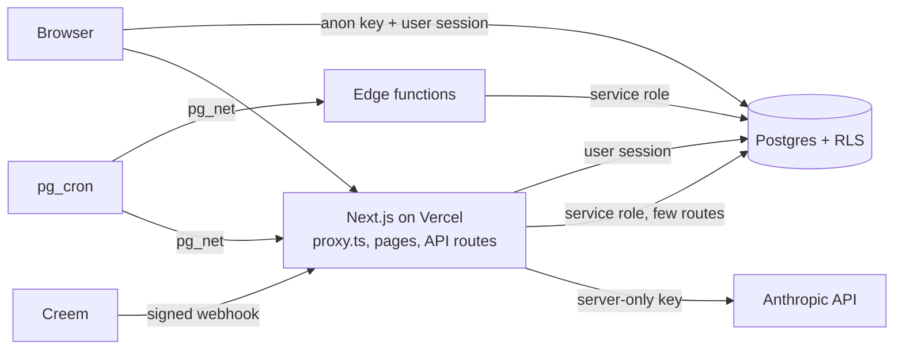

# Architecture

How PROPERWISE is put together, for developers new to the codebase. Every
path named here exists in the repository; where the code and an older
description disagree, the code wins. Greek terms are explained in
[`GLOSSARY.md`](GLOSSARY.md). Setup and checks are in
[`../CONTRIBUTING.md`](../CONTRIBUTING.md).

## Stack

- **Next.js 16, App Router, TypeScript**, deployed on Vercel. Request
  interception is `proxy.ts` at the repository root (the `middleware` file
  convention is deprecated and renamed to `proxy` in this Next.js version;
  see `node_modules/next/dist/docs/01-app/03-api-reference/03-file-conventions/proxy.md`).
- **Supabase**: Postgres with Row-Level Security, auth, storage, Deno edge
  functions, and `pg_cron` with `pg_net` for schedules.
- **Anthropic API** for reading scanned documents and for Noa, the assistant.
- **Creem** as merchant of record for subscriptions.
- **Resend** for email, **Sentry** for errors (optional), **Cloudflare
  Turnstile** on auth forms (optional).
- **GitHub Actions** for CI, Supabase deploys and scheduled checks.

## Layers

```
app/          Next.js routes: public site, /en, auth, the dashboard, token pages, API routes
components/   Shared UI on one token layer (components/tokens, app/globals.css)
lib/          Domain logic: tax, billing, calendar, data access, legal, i18n, assistant
supabase/     migrations/ (schema, RLS, SQL functions), functions/ (edge functions), config.toml
scripts/      Guards, ratchets, the test runner, db-replay, browser scanners, generators
docs/         Engineering, database, infrastructure, performance and organisation notes
```

### `app/`: routes

- **Public site.** Landing page, guides (`app/odigos/`), calculators
  (`app/ergaleia/` and one folder per calculator, for example
  `app/ypologismos-enfia/`), pricing (`app/paketa/`), legal pages. English
  pages live under `app/en/`. Public calculators call the same `lib/`
  functions as the app.
- **Auth.** `app/login/`, `app/signup/`, `app/reset-password/`,
  `app/verify/`, `app/auth/callback/`.
- **The dashboard** (`app/dashboard/`) is the signed-in app. `page.tsx` is a
  single client component that renders tabs; tabs are loaded lazily from
  `app/dashboard/components/lazyTabs`. Tab components live in
  `app/dashboard/components/` and its subfolders (`accounting/`,
  `calendar/`, `clients/`, `loan/`, `prostasia/` and others).
- **Token pages.** Pages that open without an account, authorised by an
  unguessable token in the URL: tenant portal (`app/portal/[token]`),
  accountant read link (`app/accountant/[token]`), guest check-in
  (`app/checkin/[token]`), the read-only calendar subscription feed
  (`app/imerologio/[token]/route.ts`) and the "I paid" confirmation from
  reminder emails (`app/plirosa/[token]`).
- **Accountant workspace.** `app/accountant/workspace/` is the signed-in
  view for accounting firms (see [Accountant and firm accounts](#accountant-and-firm-accounts)).
- **API routes** under `app/api/`: `anthropic` (scan and Noa), `billing/*`
  (checkout, Creem webhook, plan, portal, tester code), `push` (daily
  notifications, called by `pg_cron`), `inbound` (email-in), `e2`, `portal`,
  `account/delete`, `support`, `withdrawal` and others.

### `lib/`: domain logic

One folder per domain. The ones a newcomer meets first:

| Folder | Holds |
|---|---|
| `lib/tax/` | Greek tax rules: tax calendar, ΑΑΔΕ document types, Ε2, lease declaration, short-term rental tax. Protected path. |
| `lib/billing/` | Despite the name, two things: subscription billing (`plans.ts`, `entitlements.ts`, `morWebhook.ts`, `merchant/`) and property money and tax maths (`greekTax.ts`, `enfia.ts`, `e2.ts`, `presumptive.ts`, `scanPrompt.ts`). |
| `lib/facts/` | One function per figure shown in the app, so each number is computed once ([`docs/facts.md`](facts.md)). |
| `lib/calendar/` | Deadlines, recurrence, `.ics` import and export, the tax and ΠΕΑ calendar writers. |
| `lib/data/` | The data-access layer: typed reads and writes per table (`calendar.ts`, `expenses.ts`, `firms.ts`, ...). |
| `lib/supabase/` | The three Supabase clients: browser, server, service role. |
| `lib/auth/` | MFA rules, the second-step gate for API routes, captcha, redirects, password checks. |
| `lib/legal/` | Merchant identity, the billing wording source, subprocessors, validity of regulated values, the enforcement deadline engine (`enforcement/`). |
| `lib/assistant/` | Noa: identity, model choice, upstream error handling, evaluation set. |
| `lib/myaade/` | Rule-based parsers for documents downloaded from myAADE. |
| `lib/i18n/` | Locale handling and the English copy of public pages. |
| `lib/core/` | Formatting, dates, downloads, site URL. |

`lib/` is not framework-free. See [Known debt](#known-debt).

### `supabase/`

- `migrations/`: the whole schema, applied in filename order. Every table
  must have RLS: `scripts/guard-rls-coverage.mjs` and related guards check the
  SQL text, and `npm run db:replay` executes
  every migration on a real Postgres 16 and probes RLS as an authenticated
  user (`scripts/db/rls-probe.sql`). Protected path.
- `functions/`: Deno edge functions with shared code in `_shared/`. They do
  privileged work with the service role: email (`send-reminders`,
  `send-lifecycle-email`, `send-monthly-statements`, `schedule-email-outbox`,
  ...), calendar import from short-stay platforms (`ical-sync`), rate and
  market updaters, `health-check`, `purge-orphan-files`.
- Schedules are `pg_cron` jobs defined in migrations; they call edge
  functions or API routes through `pg_net`.
- `.github/workflows/supabase-deploy.yml` deploys migrations and functions:
  `claude/**` branches to staging, `main` to production.

### `scripts/`

- `scripts/guard-*.mjs`: guards, run together by `scripts/run-guards.mjs`,
  each proven by a mutation in `scripts/lib/mutations.mjs`.
- Ratchets: `lint-ratchet.mjs`, `color-ratchet.mjs`, `optiki-ratchet.mjs`,
  `perf-budget.mjs`, `server-weight.mjs` and the `*-baseline.json` files.
- `test.mjs`: the test runner. `db-replay.sh` and `scripts/db/`: the database
  replay.
- `e2e-*.mjs`: browser scanners (layout, keyboard, accessibility, touch,
  money paths). Many render the real dashboard components from a bench built
  by `scripts/perf-bench/build-mobile.mjs`.
- `rebranch.sh`: restacks a branch after a squash merge.

## Data flow



1. **Most reads and writes go straight from the browser to Postgres**
   through PostgREST, with the anon key and the user's session
   (`lib/supabase/client.ts`). RLS decides every row.
2. **Server code** uses `lib/supabase/server.ts`, the same anon key with the
   session from cookies (`@supabase/ssr`).
3. **The service role** (`lib/supabase/service.ts`) bypasses RLS. It is used
   only where no user session exists or RLS cannot judge: the Creem webhook,
   token pages, some cron routes. Guards keep it out of client code.
4. **Screens should not call `supabase.from(...)` directly** for tables that
   have a data-layer module. `scripts/guard-data-layer.mjs` holds the list of
   tables that already moved to `lib/data/`; the rest are migrated one table
   at a time.
5. **Figures** come from `lib/facts/`, which calls `lib/tax/` and
   `lib/billing/`. A tax or price figure typed by hand in copy fails a guard.

## Auth and the second step

- **Sign-in** is Supabase auth: email and password, or Google
  (`app/GoogleButton.tsx`). Optional Turnstile captcha (`lib/auth/captcha.ts`)
  and a leaked-password check (`lib/auth/leakedPassword.ts`).
- **Second step** is TOTP via Supabase MFA. A session that has only the
  password while the user has a verified factor carries `aal1`. The verdict
  is one function, `sessionNeedsSecondStep` in `lib/auth/mfa.ts`, enforced at
  three layers:
  1. **Pages.** `proxy.ts` sends a signed-out visitor away from `/dashboard`
     and sends an `aal1` session with a verified factor back to `/login`,
     where the same screen asks for the six-digit code. The accountant
     workspace is included.
  2. **API routes.** `/api/**` is excluded from those redirects. Each route
     checks the user itself and calls `requireSecondStep` from
     `lib/auth/secondStep.ts`. `scripts/guard-api-auth.mjs` fails if a route
     forgets.
  3. **Database.** `private.mfa_satisfied()` is true for an `aal2` token or a
     user with no verified factor. A restrictive RLS policy on each user-data
     table and a check inside `SECURITY DEFINER` functions require it
     (`supabase/migrations/20261003120000_to_deftero_vima_fylaei_kai_ta_dedomena.sql`).
     So a leaked password alone cannot read data through PostgREST either.
- **Firm members always need the second step**: for an active member of an
  accounting firm the database requires `aal2`, with or without a factor
  (`supabase/migrations/20261104150000_to_grafeio_krinetai_os_prosopo.sql`).
- `proxy.ts` also sets a per-request CSP nonce with `strict-dynamic` in
  production.

## Billing

- **Plans** are defined in `lib/billing/plans.ts` (`PlanId`: `free`, `solo`,
  `owner`, `agency`, `office`; monthly or annual). What each plan unlocks is
  `lib/billing/entitlements.ts`: `effectivePlan`, `hasFeature`,
  `TAB_MIN_PLAN`, property limits.
- **Trial.** The trial runs inside the app, not at the merchant
  (`trialState` in `entitlements.ts`; its length is `TRIAL_DAYS` in
  `plans.ts`). Creem products are configured without a trial.
- **Merchant of record.** Creem sells the subscription in its own name,
  issues the receipt, remits VAT and executes refunds (`lib/legal/merchant.ts`). The merchant is behind a port (`lib/billing/merchant/port.ts`,
  `merchant/index.ts`, implementation `merchant/creem.ts`). The active one is
  chosen by `MERCHANT_PROVIDER` and named in one place, `lib/legal/merchant.ts`.
- **Checkout.** `app/api/billing/checkout` (logic in `flow.ts`) requires a
  user and the second step, then opens a Creem checkout only when the gate in
  `lib/legal/checkout.ts` says billing is fully configured and the seller is
  disclosed. Plan changes ask `checkoutIsLive`, the same condition. Every page
  that describes billing gets its wording from `lib/legal/billingWords.ts`,
  which reads that condition too.
- **Webhook.** `app/api/billing/creem/route.ts` reads the raw body, verifies
  the `creem-signature` HMAC with `CREEM_WEBHOOK_SECRET` and passes the event
  to `applyMerchantEvent` in `lib/billing/morWebhook.ts`. That function maps
  the product to a plan (`CREEM_PRODUCTS`, `lib/billing/variantMap.ts`) and
  writes `billing_profiles` with the service role. Late events do not
  overwrite newer state; refunds and disputes revoke access through the
  `revoke_mor_access` SQL function. Unprocessed events return an error so
  the merchant retries and the failure is reported.
- **Server-side gates.** Paid API routes read the plan from the database
  with `lib/billing/requireFeature.ts` instead of trusting the screen's
  `hasFeature` (`scripts/guard-server-entitlements.mjs`).
  AI usage is metered per plan (`lib/billing/aiLimits.ts`,
  `lib/billing/aiUnits.ts`).

## Tax and calendar sync

- **Tax dates** come only from `lib/tax/greekTaxCalendar.ts`, through
  `taxEventsToWrite` in `lib/facts/deadlines.ts`.
- **One writer.** `lib/calendar/taxSync.ts` is the only code that writes
  `tax:*` events into `calendar_events` (ΕΝΦΙΑ instalments, Ε1 and Ε2, Ε9,
  monthly short-stay declarations). It runs when a property is saved, every
  morning from `pg_cron` through `app/api/push` before notifications, and
  when the user presses refresh in the calendar. The database keeps one row
  per key, so concurrent writers cannot duplicate. Rows the user edited are
  detected by `auto_hash` and left alone.
- **Other writers** follow the same pattern, for example ΠΕΑ expiry reminders
  (`lib/calendar/peaSync.ts`). Screens and writers reach `calendar_events`
  through `lib/data/calendar.ts` (`scripts/guard-data-layer.mjs`).
- **Out**: the calendar is read by email reminders (`send-reminders`), push
  (`app/api/push`) and the `.ics` subscription feed
  (`app/imerologio/[token]/route.ts`), which is read-only.
- **In**: `ical-sync` imports bookings from short-stay platforms on a
  schedule; the ΕΝΦΙΑ act from myAADE is parsed in the browser in a web
  worker (`lib/myaade/`), with no model involved, and saved only after the
  owner confirms.
- **Validity.** Regulated values carry a validity window
  (`lib/legal/validity.ts`); `.github/workflows/validity.yml` opens an issue
  before one expires.

## Noa, the assistant

- **UI**: `app/dashboard/components/PropertyAssistant.tsx` and
  `app/dashboard/components/assistant/`. The name comes from
  `ASSISTANT_NAME` in `lib/assistant/identity.ts`; Noa is never labelled
  "assistant" or "AI assistant" in copy (`scripts/guard-assistant-name.mjs`).
- **Server**: `app/api/anthropic/route.tsx` serves both Noa and document
  scanning. It requires a signed-in user, the second step and a same-origin
  request, takes an AI unit before calling the model and refunds it on
  upstream failure (`lib/billing/aiUnits.ts`), and enforces per-plan daily
  and monthly limits (`lib/billing/aiLimits.ts`). The system prompt is built
  by `noaSystemBlocks` in `app/dashboard/components/assistantPersona.ts`.
  The API key never reaches the browser.
- **Evaluation**: `npm run noa:eval` (`scripts/noa-eval.ts`) scores answers
  against a fixed question set (`lib/assistant/evalSet.ts`).
- **Scanning** uses the same route with a scan shape
  (`lib/assistant/scanShape.ts`) and the prompt in `lib/billing/scanPrompt.ts`.
  The result is a draft; nothing is saved until the owner confirms.

## Accountant and firm accounts

Two separate ways for an accountant to see an owner's data:

1. **Read link.** The owner shares a token link (`accountant_links`); the
   page `app/accountant/[token]` reads through `get_accountant_data`. No
   account and no writes. The owner revokes it by rotating or deleting the
   link.
2. **Firm workspace.** Every accountant with an account belongs to a firm
   (`firms`, `firm_members`); a solo accountant is a one-member firm. Roles:
   `manager` (all clients, members, assignments, history), `accountant`
   (assigned clients) and `associate` (assigned clients, read only). The
   owner grants each firm an access level on `accountant_clients.access_level`:
   `read`, `upload` (files into an existing property's folder) or `keep`
   (bookkeeping on existing properties). Owner-side UI:
   `app/dashboard/components/FirmAccess.tsx`, `AccountantInvites.tsx`.

Rules that hold at every level, enforced in SQL
(`supabase/migrations/20261104120000_ta_logistika_grafeia.sql`,
`20261104130000_ta_grafeia_grafoun.sql`, `20261104150000_to_grafeio_krinetai_os_prosopo.sql`):

- The owner's RLS policies do not change for firms. Firm reads and writes
  go through `SECURITY DEFINER` functions that check member, firm, role,
  assignment and level; associates stay read only at every level.
- No firm can create or delete properties, change settings, plan, billing,
  members or access, or change the owner's records.
- Every firm write is logged with before and after (`firm_record_log`); the
  owner sees a daily summary and can undo recent changes (`firm_record_undo`,
  window `FIRM_UNDO_DAYS` in `lib/legal/firms.ts`). Opening a client is
  logged in `firm_access_log`.

## CI and scheduled checks

- `ci.yml` runs on every pull request to `main`. Six jobs run in parallel:
  `verify` (security scan, audit, lint ratchet, typecheck for the app and the
  Deno functions, guards and their mutations, ratchets, db-replay, tests,
  build, bundle secret scan) and the browser jobs `rendered`, `scans`,
  `scans-light`, `layout` and `layout-webkit`. Only `gate` has `needs:`; it
  waits for all six and passes only if all of them passed.
- A PR with a merge conflict runs no CI; see the rebranch rule in
  `CONTRIBUTING.md`.
- Scheduled workflows: tax-data validity, ΑΑΔΕ form editions, the ΕΛΣΤΑΤ
  rent index, price freshness, a daily security sweep, a weekly production
  quality pass, backups and a backup watchdog.
- `health.yml` is not scheduled: it runs on push to `main` and on
  `workflow_dispatch`. Between releases the `health-check` edge function runs
  from pg_cron.

## Known debt

Stated plainly so that nobody builds on a wrong assumption.

- **Domain code inside `app/`.** `app/dashboard/components/` and its
  subfolders contain 69 `.ts` files that are not tests and not components:
  exports, report builders, persona and prompt text, parsers, catalogues.
  Examples: `accountantExport.ts`, `e2Export.ts`, `exportXlsx.ts`,
  `assistantPersona.ts`, `myaadeWorker.ts`, `insurance/catalog.ts`. They
  belong in `lib/` and move gradually.
- **`lib/` imports from `app/`.** Six non-test files in `lib/` import from
  `app/`:
  - `lib/myaade/readPdf.ts` (`app/dashboard/components/myaadeWorker`)
  - `lib/seo/llms.ts` (`app/odigos/guides`)
  - `lib/i18n/en/legal/terms.ts` and `lib/i18n/en/legal/privacy.ts` (`app/legal-shell`)
  - `lib/i18n/en/landingStats.ts` (`app/dashboard/components/insurance/catalog`)
  - `lib/i18n/en/tools/buy.tsx` (`app/ToolParts`, `app/exoda-agoras-akinitou/lines`)
- **`lib/` is not framework-free.** Besides the above, eight non-test files
  in `lib/` depend on Next: seven import from `next/*`
  (`lib/auth/secondStep.ts`, `lib/billing/requireFeature.ts`,
  `lib/billing/morWebhook.ts`, `lib/supabase/server.ts`,
  `lib/observability/route.ts`, `lib/i18n/useLocale.ts`,
  `lib/i18n/serverLocale.ts`) and `lib/seo/noindex.ts` has a type import from
  `'next'`. The README's
  repository layout still describes `lib/` as framework-free; that line is
  out of date.
- **`lib/billing/` mixes concerns**: subscription billing and property tax
  maths share one folder.
- **The data layer is partial.** Only the tables listed in
  `scripts/guard-data-layer.mjs` have moved to `lib/data/`; other screens
  still call Supabase directly.
- **Per-instance rate limiting.** The per-minute limiter in
  `app/api/anthropic/route.tsx` is an in-memory map, so on serverless it is
  per instance. The comment in that file says so; the shared limits are the
  database-backed AI units.
- **Large client page.** `app/dashboard/page.tsx` is one client component
  that holds the tab shell and much of its state.
- **Language.** Most comments, guard messages and internal docs are Greek.
  The language policy in `CONTRIBUTING.md` sets English for new comments and
  translates the rest gradually.
